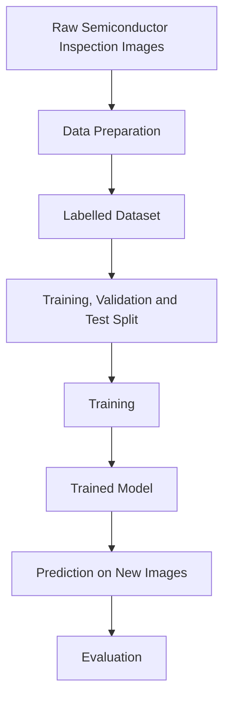

# Mission 1 – Data Behind Deep Learning

## 1. Introduction

Deep learning is a branch of machine learning that uses neural networks to learn patterns from large amounts of data. Before a neural network can learn, the collected data must be properly prepared, organised and labelled.

For example, consider a semiconductor manufacturing company that wants to develop a deep learning system to identify defects in semiconductor inspection images. The system requires properly prepared images to learn the difference between defective and non-defective components.

Data preparation plays an important role because the quality of the input data directly affects what the neural network can learn.

## 2. From Raw Data to Model Input

A digital image is made up of small units called pixels. Each pixel represents a particular colour or intensity value.

There are two common types of image representation:

- **Grayscale Image:** Each pixel contains an intensity value generally ranging from 0 to 255, where 0 represents black and 255 represents white.
- **RGB Image:** Each pixel is represented using three colour channels: Red, Green and Blue. Each channel generally contains a value between 0 and 255.

A neural network processes numerical information rather than understanding an image like a human. Therefore, an image must be converted into numerical values before it can be used as an input.

For example, a semiconductor inspection image can be represented as a numerical array containing pixel values. These values are provided to the neural network as input data.

## 3. Data Preparation

Data preparation is the process of converting raw data into a suitable format for training a machine learning model.

The important data preparation steps include:

**1. Resizing**

Images may have different dimensions. Resizing converts them into a consistent size so that the neural network receives inputs with the same dimensions.

For example, all semiconductor inspection images can be resized to 128 × 128 pixels.

**2. Cleaning**

Cleaning involves identifying and removing corrupted, duplicate, irrelevant or poor-quality images that may affect model training.

**3. Formatting**

Images are converted into a numerical format that the neural network can process. For example, image pixels can be represented as numerical arrays.

**4. Normalisation**

Normalisation is the process of scaling numerical values into a smaller range.

For example, pixel values ranging from 0 to 255 can be scaled to a range between 0 and 1 by dividing each pixel value by 255.

Normalisation helps maintain consistent input values and can make neural network training more stable.

## 4. Labels and Examples

A dataset consists of individual examples called samples. Each sample contains input data and may have a corresponding label.

A label represents the correct output or category associated with a particular example.

In semiconductor defect detection, the engineering team can classify inspection images into two categories:

- **Defect:** The image contains a manufacturing defect.
- **No Defect:** The image does not contain a visible manufacturing defect.

For example, an image containing a scratch on a semiconductor wafer can be labelled as Defect, while an image without any visible defect can be labelled as No Defect.

These labelled examples are used during supervised learning to help the neural network understand the relationship between image patterns and their corresponding categories.

## 5. Data Quality

Data quality is important because a neural network learns patterns from the examples provided during training.

Poor-quality data can affect the model's ability to learn correct patterns and produce reliable predictions.

Some common data quality problems include:

**1. Incorrect Labels**

If a defective image is incorrectly labelled as No Defect, the model receives misleading information and may learn incorrect patterns.

**2. Duplicate Images**

Duplicate images cause repeated examples in the dataset. This can affect learning and may lead to misleading evaluation results if similar images appear in both training and test datasets.

**3. Noisy Images**

Blurred, distorted or unclear images may make it difficult for the model to identify important features and defect patterns.

**4. Missing Examples**

If certain defect categories are not sufficiently represented in the dataset, the model may fail to recognise those defects when they appear in new images.

Therefore, data should be checked carefully before training a neural network.

## 6. Representativeness and Class Imbalance

A dataset should represent the different types of examples that the model may encounter in real-world applications.

Class imbalance occurs when one category contains significantly more examples than another category.

For example, consider a semiconductor inspection dataset containing:

- 9,000 images of non-defective components.
- 1,000 images of defective components.

In this situation, the dataset is imbalanced because non-defective images greatly outnumber defective images.

The model may become biased towards predicting the majority class. It might achieve high overall accuracy while failing to identify many actual defects.

Some ways to address class imbalance include:

- Collecting more examples from the minority class.
- Using data augmentation techniques to create additional training examples.
- Applying class weighting during model training.
- Monitoring precision, recall and other evaluation metrics instead of relying only on accuracy.

A balanced and representative dataset helps the model learn different categories more effectively.

## 7. Training, Validation and Test Datasets

Before training a neural network, the available dataset is generally divided into three separate parts.

**1. Training Dataset**

The training dataset is used to train the neural network. The model learns patterns from these examples by adjusting its weights and biases.

**2. Validation Dataset**

The validation dataset is used to monitor the model's performance during development. It helps engineers compare different model configurations and tune hyperparameters.

**3. Test Dataset**

The test dataset is used to evaluate the final trained model using previously unseen examples. It provides an estimate of how well the model can perform on new data.

The test dataset should not be repeatedly used to guide training decisions because this can lead to overfitting to the test data and an unreliable evaluation.

Keeping these datasets separate helps engineers understand whether the model has learned useful patterns rather than simply memorising the training examples.

## 8. Data Preparation Workflow

The following workflow represents the complete process from collecting raw semiconductor inspection images to evaluating the trained model.

### Flow Diagram

### Explanation of Each Stage

**1. Raw Images**

Inspection images are collected from semiconductor manufacturing processes. These images may contain defective as well as non-defective components.

**2. Data Preparation**

The collected images are resized, cleaned, formatted and normalised to make them suitable for neural network training.

**3. Labelled Dataset**

Each image is assigned an appropriate label, such as Defect or No Defect. These labels provide the correct target outputs during supervised learning.

**4. Dataset Splitting**

The labelled dataset is divided into training, validation and test datasets. Each dataset serves a different purpose during model development and evaluation.

**5. Training**

The neural network processes the training images and learns patterns by adjusting its weights and biases.

**6. Trained Model**

After training, the model contains learned parameters that help it identify patterns associated with different defect categories.

**7. Prediction**

The trained model receives a new semiconductor inspection image and predicts whether it contains a defect.

**8. Evaluation**

The model's predictions are compared with the actual labels to measure its performance and determine how well it works on unseen images.

## 9. Two Data-Related Problems That Can Affect Final Predictions

### Problem 1: Incorrect Labelling

If defective semiconductor images are incorrectly labelled as non-defective, the neural network receives misleading information during training.

For example, if an image containing a scratch is labelled as No Defect, the model may learn an incorrect relationship between the image and its expected output.

As a result, it may incorrectly classify similar defective images when it encounters new inspection data.

### Problem 2: Class Imbalance

If the dataset contains many non-defective images but very few defective images, the neural network may become biased towards predicting No Defect.

For example, a model trained mostly on non-defective images may achieve high overall accuracy while missing actual manufacturing defects.

This can be a serious problem because defective components may pass inspection and affect manufacturing quality.

Collecting more representative examples and using suitable class imbalance techniques can help reduce this problem.

## 10. Conclusion

Data preparation is one of the most important stages in deep learning. The quality, quantity and representation of data directly influence what a neural network can learn.

In semiconductor defect detection, properly prepared and labelled inspection images help the neural network identify defect patterns more effectively.

Resizing, cleaning, formatting and normalising images make the data suitable for training. Separating the dataset into training, validation and test sets helps engineers evaluate the model's ability to generalise to unseen data.

This mission helped me understand that building a reliable deep learning system does not depend only on the neural network architecture. It also depends on the quality of the data used to train and evaluate the model.
