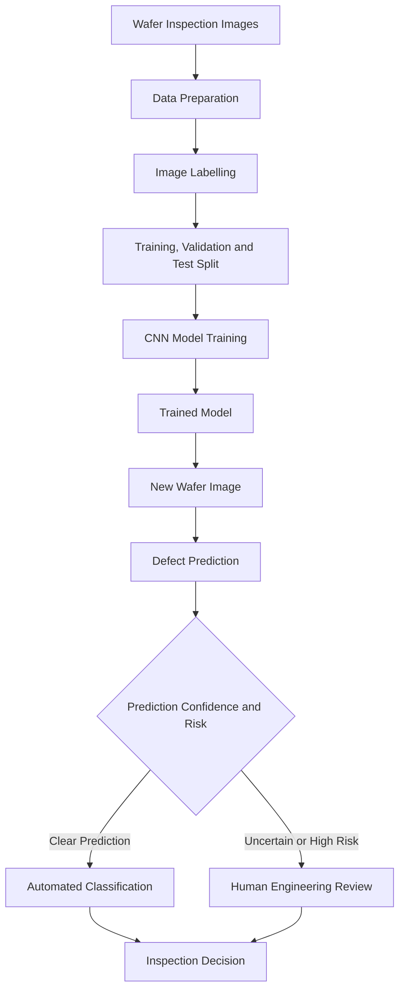

# Final Challenge – Engineering Case Study

## Title: Deep Learning-Based Semiconductor Wafer Defect Detection

## 1. Engineering Problem

Semiconductor manufacturing involves several complex processes, and defects can occur during wafer fabrication.

Common wafer defects include scratches, stains, holes and other surface irregularities. These defects can affect product quality, manufacturing yield and production costs.

Traditional inspection methods may depend on manual examination or predefined image-processing techniques. These approaches can become challenging when defect patterns are complex or vary significantly.

The proposed solution is to develop a deep learning-based system that analyses semiconductor wafer inspection images and identifies possible defects automatically.

## 2. Input Data Required

The system requires semiconductor wafer inspection images collected during the manufacturing process.

The input dataset may include:

- Images of wafers without defects.
- Images containing scratches.
- Images containing stains.
- Images containing holes.
- Images containing other defect patterns.

Each image should be associated with an appropriate label indicating its defect category.

A sufficiently large and representative dataset is required to train and evaluate the model.

## 3. Data Preparation and Labels

Before training, the collected images must be prepared.

The preparation process includes:

1. Removing corrupted and duplicate images.
2. Resizing images to a consistent dimension.
3. Normalising pixel values.
4. Checking the correctness of image labels.
5. Dividing the dataset into training, validation and test sets.

Possible labels include:

- Defect
- No Defect
- Scratch
- Stain
- Hole

The dataset should represent different defect categories adequately. If some categories contain fewer images, suitable techniques such as data augmentation or class weighting can be considered.

## 4. What Should the Model Predict?

The model should analyse an input wafer image and identify whether it contains a defect.

For a basic implementation, the model can perform binary classification:

- Defect
- No Defect

An advanced implementation can perform multiclass classification to identify specific defect categories such as scratches, stains and holes.

A Convolutional Neural Network (CNN) is a suitable candidate because it can learn visual features directly from image data.

## 5. Why Might Deep Learning Be Suitable?

Deep learning may be suitable because semiconductor wafer inspection involves complex visual patterns.

A CNN can automatically learn useful image features such as edges, textures, shapes and defect patterns.

This reduces the need to manually define every visual feature.

Deep learning can also support classification of multiple defect categories when trained with suitable labelled datasets.

Published research by Chien, Wu and Lee (2020) demonstrated the use of CNN-based models to classify four types of semiconductor wafer surface defects: center, local, random and scrape.

Their proposed CNN achieved an average classification accuracy of 98.88% in their reported experiment.

This provides research evidence that CNN-based approaches can be useful for semiconductor wafer defect classification.

## 6. Could Traditional ML or Rule-Based Approaches Also Be Used?

Yes. Different approaches should be considered before selecting a final solution.

**Rule-Based Approach:**

A rule-based approach can identify defects using predefined thresholds or image-processing conditions. It may work well when defect characteristics are clearly defined.

**Traditional Machine Learning:**

Algorithms such as Support Vector Machines (SVM) and Random Forest can classify defects using manually extracted features such as defect size, shape and texture.

**Deep Learning:**

Deep learning may be more suitable when inspection images contain complex visual patterns that are difficult to describe manually.

The final choice should depend on dataset size, computational resources, accuracy requirements and practical constraints.

## 7. How Would the Model Be Evaluated?

The trained model should be evaluated using a separate test dataset that was not used during training or model selection.

The following evaluation metrics can be considered:

- **Accuracy:** Measures the proportion of total predictions that are correct.
- **Precision:** Measures how many images predicted as defective are actually defective.
- **Recall:** Measures how many actual defective images are correctly identified.
- **F1-score:** Combines precision and recall into a single metric.
- **Confusion Matrix:** Shows the correct and incorrect predictions for each category.

Recall is particularly important in defect detection because missing an actual defect may allow a defective wafer to proceed to the next manufacturing stage.

The model should also be tested on images collected under different manufacturing conditions to evaluate its ability to generalise.

## 8. Possible Incorrect Predictions and Their Consequences

### False Positive

A false positive occurs when the model predicts a defect in an image that is actually non-defective.

This may lead to unnecessary inspection, rejection or additional manufacturing costs.

### False Negative

A false negative occurs when the model predicts that an image has no defect even though a defect is present.

This is particularly serious because a defective wafer may pass inspection and continue through the manufacturing process.

Both types of errors should be monitored during model evaluation.

## 9. Where Would Human Review and Engineering Judgement Remain Necessary?

Human review remains important even when deep learning is used.

Engineers should:

- Review uncertain or high-risk predictions.
- Verify suspected defects.
- Investigate new or unusual defect patterns.
- Monitor model performance over time.
- Check whether inspection results are consistent with manufacturing requirements.

The model should support engineering decisions rather than completely replace engineering judgement.

## 10. Proposed System Workflow

The following flowchart represents the proposed deep learning-based semiconductor wafer defect detection system.

This workflow represents a proposed system design based on the concepts investigated in this assignment. It is not a claim that this exact system has been deployed in a manufacturing facility.

## 11. Research Evidence

### Research Paper 1

**Title:** Inspection and Classification of Semiconductor Wafer Surface Defects Using CNN Deep Learning Networks.

**Authors:** Jong-Chih Chien, Ming-Tao Wu and Jiann-Der Lee.

**Published:** 2020, Applied Sciences, Volume 10, Issue 15.

**Link:** https://www.mdpi.com/2076-3417/10/15/5340

**Key Findings:**

The researchers investigated CNN-based classification of semiconductor wafer surface defects.

The study classified four defect categories: center, local, random and scrape.

The proposed CNN achieved an average classification accuracy of 98.88% in the reported experiment and performed better than the investigated SVM approach.

This research demonstrates the potential of deep learning for semiconductor wafer defect classification.

### Research Paper 2

**Title:** Defect Detection and Classification on Semiconductor Wafers Using Two-Stage Geometric Transformation-Based Data Augmentation and SqueezeNet Lightweight Convolutional Neural Network.

**Published:** 2023, Computers & Industrial Engineering, Volume 183, Article 109549.

**Link:** https://www.sciencedirect.com/science/article/abs/pii/S0360835223005739

**Key Findings:**

This research investigated semiconductor wafer defect detection and classification using data augmentation and a lightweight CNN architecture called SqueezeNet.

The study combined geometric transformation-based data augmentation with deep learning to improve defect classification.

It also investigated computational efficiency, making the approach relevant to applications where processing resources and time are important considerations.

This research demonstrates another approach to applying CNN architectures in semiconductor defect inspection.

## 12. Conclusion

Deep learning can be a useful approach for semiconductor wafer defect detection because it can learn complex visual patterns from inspection images.

CNN-based models can help identify and classify different defect categories and support automated inspection.

Published research demonstrates the potential of CNN architectures and data augmentation techniques for semiconductor wafer defect classification.

However, model performance depends on data quality, class balance, training methods and evaluation on unseen data.

Traditional machine learning and rule-based approaches should also be considered when selecting a suitable solution.

Human inspection and engineering judgement remain important for verifying uncertain predictions and ensuring manufacturing quality.

This case study helped me understand how deep learning concepts can be connected to practical semiconductor manufacturing problems and how neural networks can support engineering inspection tasks.
