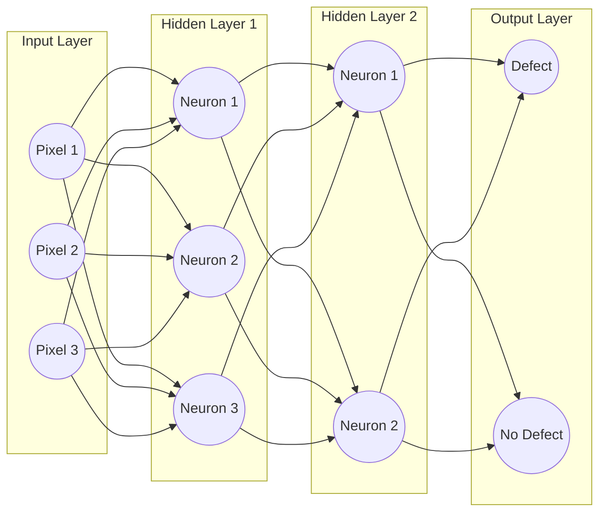

# Mission 3 – Open the Neural Network

## 1. Introduction

A neural network is a computational model used in deep learning to identify patterns and relationships in data.

It consists of interconnected processing units called neurons or nodes, which are organised into different layers.

A basic neural network contains three main types of layers:

1. Input Layer
2. Hidden Layer
3. Output Layer

Each layer performs a specific function in processing information. The input layer receives data, hidden layers process the information and learn patterns, and the output layer generates the final prediction.

In semiconductor defect detection, a neural network receives an inspection image, processes its numerical information and produces a prediction indicating whether the image may contain a defect.

## 2. Components of a Neural Network

### 2.1 Input Layer

The input layer is the first layer of a neural network. It receives the input data and passes it to the next layer.

The input can be numerical values, image pixels, audio signals or other types of data depending on the application.

In semiconductor defect detection, the input consists of numerical pixel values obtained from an inspection image.

For example, if an image is resized to 128 × 128 pixels with three colour channels (RGB), the network receives numerical information representing those pixels.

### 2.2 Hidden Layers

Hidden layers are located between the input layer and the output layer.

They process the information received from the previous layer and identify useful patterns in the data.

A neural network may contain one or more hidden layers. Deep learning models generally contain multiple hidden layers.

In image classification, different hidden layers can learn different levels of visual features:

- Early layers may identify edges and lines.
- Intermediate layers may identify shapes and textures.
- Deeper layers may identify more complex visual patterns.

These learned features help the network perform classification tasks.

### 2.3 Output Layer

The output layer is the final layer of a neural network. It produces the prediction based on the information processed by the previous layers.

For a binary semiconductor defect classification problem, the output represents two possible categories:

- Defect
- No Defect

The output may be represented using probabilities that indicate the model's confidence in each category.

The category with the higher predicted probability can be selected as the model's predicted class.

### 2.4 Neurons or Nodes

Neurons are the basic computational units of a neural network.

Each neuron receives inputs, performs calculations using weights and a bias, applies an activation function and passes the result to the next layer.

A layer generally contains multiple neurons, allowing the network to process different combinations of input information.

The interconnected neurons help the network identify relationships and learn patterns from data.

### 2.5 Weights and Biases

**Weights:**

Weights determine the importance of different inputs when a neuron performs its calculations.

Each connection between neurons has an associated weight. Different weights allow the network to assign different levels of importance to different input values.

During training, the network adjusts these weights to improve its predictions.

**Biases:**

Bias is an additional learnable parameter associated with a neuron.

It helps adjust the neuron's output independently of the input values and allows the network to learn more flexible relationships.

Both weights and biases are updated during training to reduce prediction errors.

### 2.6 Activation Functions

An activation function determines how the output of a neuron is transformed before being passed to the next layer.

It introduces non-linearity into the network, allowing it to learn complex patterns and relationships that cannot be represented effectively using only linear operations.

Some commonly used activation functions include:

- **ReLU (Rectified Linear Unit):** Converts negative values to zero and keeps positive values unchanged. It is commonly used in hidden layers.
- **Sigmoid:** Converts values into a range between 0 and 1. It is commonly used for binary classification outputs.
- **Tanh:** Converts values into a range between -1 and 1.
- **Softmax:** Converts output values into probabilities across multiple classes.

The choice of activation function depends on the network architecture and the problem being solved.

## 3. How Information Passes Through a Neural Network

Consider a semiconductor inspection system designed to identify defective components.

The process works as follows:

1. An inspection image is collected from the semiconductor manufacturing process.
2. The image is converted into numerical pixel values.
3. The input layer receives these numerical values.
4. The hidden layers process the information and identify useful visual patterns.
5. Neurons perform calculations using weights, biases and activation functions.
6. The processed information reaches the output layer.
7. The output layer produces a prediction indicating whether the image is likely to contain a defect or no defect.

This process of passing information from the input layer to the output layer is called forward propagation or a forward pass.

## 4. Labelled Neural Network Diagram

The following diagram represents a basic feedforward neural network used for semiconductor defect classification.

### Diagram Explanation

- **Input Layer:** Receives numerical pixel values from the semiconductor inspection image.
- **Hidden Layer 1:** Processes the input and identifies basic visual features.
- **Hidden Layer 2:** Processes the learned features to identify more complex patterns.
- **Output Layer:** Produces the final classification as Defect or No Defect.
- **Connections:** Represent the flow of information between neurons. Each connection has an associated weight.

Note: The diagram is a simplified conceptual representation. An actual neural network may contain thousands or millions of input values and many more neurons.

## 5. Example: Tracing One Image from Input to Output

Consider a semiconductor inspection image containing a visible scratch.

The process can be explained step by step:

**Step 1 – Input**

The inspection image is converted into numerical pixel values and provided to the input layer.

**Step 2 – Feature Processing**

The hidden layers process the numerical information and learn visual features such as edges, textures and shapes that may be associated with defects.

**Step 3 – Neuron Calculations**

The neurons process the incoming information using their weights, biases and activation functions.

**Step 4 – Output**

The output layer generates probabilities for the two possible categories.

For example, the model may produce the following illustrative results:

- Defect: 0.92
- No Defect: 0.08

**Step 5 – Prediction**

Since the predicted probability for Defect is higher, the model classifies the inspection image as Defect.

These probability values are illustrative and do not represent the results of an actual trained model.

## 6. Why Is a Prediction Not Automatically Proof of a Defect?

A neural network prediction is based on patterns learned from its training data. It does not guarantee that a defect actually exists.

The model may produce incorrect predictions due to several reasons:

- Poor-quality or unclear input images.
- Incorrect labels in the training dataset.
- Insufficient training examples.
- New defect patterns that were not present during training.
- Similar visual characteristics between defective and non-defective images.

Therefore, predictions must be evaluated using reliable test data.

In important manufacturing applications, human inspection or additional engineering verification may also be required before making final decisions.

## 7. Conclusion

A neural network processes numerical information through interconnected layers to identify patterns and produce predictions.

The input layer receives data, hidden layers learn useful features, and the output layer generates the final result.

Neurons, weights, biases and activation functions work together to process information and help the network learn patterns during training.

In semiconductor defect detection, neural networks can help identify possible manufacturing defects from inspection images. However, their predictions must be properly evaluated before being used in practical applications.

Through this mission, I understood the basic internal structure of a neural network and how information moves through its different layers to produce a prediction.
