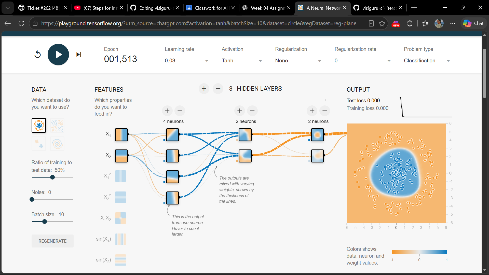

# Mission 5 – Experiment and Observe

## 1. Objective

The objective of this experiment was to investigate whether increasing neural network complexity always improves classification performance.

I used TensorFlow Neural Network Playground to compare two neural network configurations: a baseline network with two hidden layers and a modified network with three hidden layers.

The experiment helped me understand how changing the number of hidden layers affects the network's learning behaviour, decision boundary and classification performance.

## 2. Experiment Tool

**Tool:** TensorFlow Neural Network Playground

**Website:** https://playground.tensorflow.org/

TensorFlow Playground is an interactive tool that allows users to experiment with neural network architectures and observe their training behaviour without writing Python code.

## 3. Experiment A – Baseline Configuration

The first experiment used a neural network containing two hidden layers.

### Configuration

- Problem Type: Classification
- Dataset: Circle
- Hidden Layers: 2
- Neurons per Layer: 4 and 2
- Activation Function: Tanh
- Learning Rate: 0.03
- Regularization: None
- Regularization Rate: 0
- Noise: 0
- Training-to-Test Ratio: 50%
- Batch Size: 10
- Epoch: 1,517

### Network Architecture

Input Layer → Hidden Layer 1 (4 neurons) → Hidden Layer 2 (2 neurons) → Output Layer

### Observations

At epoch 1,517, the displayed training loss was 0.000 and the displayed test loss was 0.000.

The decision boundary successfully separated the central blue points from the surrounding orange points.

The baseline network learned the Circle classification pattern successfully.

### Screenshot – Experiment A

## 4. Experiment B – Modified Configuration

In the second experiment, I added one more hidden layer while keeping all the other settings unchanged.

### Configuration

- Problem Type: Classification
- Dataset: Circle
- Hidden Layers: 3
- Neurons per Layer: 4, 2 and 2
- Activation Function: Tanh
- Learning Rate: 0.03
- Regularization: None
- Regularization Rate: 0
- Noise: 0
- Training-to-Test Ratio: 50%
- Batch Size: 10
- Epoch: 1,513

### Network Architecture

Input Layer → Hidden Layer 1 (4 neurons) → Hidden Layer 2 (2 neurons) → Hidden Layer 3 (2 neurons) → Output Layer

### Observations

At epoch 1,513, the displayed training loss was 0.000 and the displayed test loss was 0.000.

The decision boundary successfully separated the central blue points from the surrounding orange points.

The modified network also learned the Circle classification pattern successfully.

### Screenshot – Experiment B

## 5. Comparison of Both Experiments

| Measurement | Experiment A | Experiment B |
|---|---|---|
| Hidden Layers | 2 | 3 |
| Neurons per Layer | 4, 2 | 4, 2, 2 |
| Epoch | 1,517 | 1,513 |
| Training Loss | 0.000 | 0.000 |
| Test Loss | 0.000 | 0.000 |
| Activation Function | Tanh | Tanh |
| Learning Rate | 0.03 | 0.03 |
| Regularization | None | None |
| Regularization Rate | 0 | 0 |
| Noise | 0 | 0 |
| Training-to-Test Ratio | 50% | 50% |
| Batch Size | 10 | 10 |

Both experiments were performed using the same displayed settings, except for the additional hidden layer in Experiment B.

The displayed training and test loss values were identical in both experiments.

The loss values are rounded to three decimal places, so a displayed value of 0.000 does not necessarily mean that the actual loss is exactly zero.

## 6. Answers to the Investigation Questions

### Q1. What changed when I modified the network?

I added a third hidden layer containing two neurons. The network became more complex, increasing the total number of hidden neurons from six to eight.

The dataset and all the other displayed settings remained unchanged.

### Q2. Did the more complex network always perform better?

No. Both networks displayed the same training loss and test loss of 0.000.

Both configurations learned the Circle classification pattern successfully. Adding another hidden layer did not produce a visible improvement in the displayed loss values.

This demonstrates that increasing network complexity does not automatically guarantee better performance.

### Q3. What did I observe about the relationship between model complexity and the patterns a network can learn?

A network with more hidden layers can learn complex patterns because it has greater capacity to represent relationships in data.

However, increasing the number of layers and neurons does not always improve performance.

A simpler network may be sufficient for an easier classification problem, while a more complex network may be useful for problems involving more complicated patterns.

### Q4. Why should training performance not be the only measure of success?

Training loss measures how well the model performs on training examples, whereas test loss provides information about its performance on separate examples.

A model may perform very well on training data but poorly on unseen data. This is known as overfitting.

Therefore, both training and test performance should be considered when evaluating a model.

### Q5. How is this experiment different from training a model on real semiconductor inspection images?

TensorFlow Playground uses a simple synthetic Circle dataset containing two-dimensional points.

Real semiconductor inspection involves images, image quality issues, different defect types and manufacturing variations.

A practical semiconductor defect detection system requires representative image datasets, suitable neural network architectures, sufficient computational resources and careful evaluation.

Results obtained using the Playground do not establish that the same network architecture would work effectively for semiconductor inspection.

### Q6. What additional evidence would be needed before claiming that a model is suitable for practical use?

A practical application would require:

- Representative and correctly labelled semiconductor inspection images.
- Reliable evaluation using unseen test data.
- Testing under different inspection and manufacturing conditions.
- Analysis of false positives and false negatives.
- Evaluation using accuracy, precision, recall and F1-score.
- Assessment of computational requirements and processing time.
- Engineering review and verification of important predictions.

These steps help determine whether a model is reliable enough for practical engineering applications.

## 7. Conclusion

Both network configurations successfully learned the Circle classification pattern.

The baseline network with two hidden layers and the modified network with three hidden layers displayed identical training and test loss values of 0.000.

The experiment showed that adding another hidden layer did not produce a visible improvement in the displayed performance for this particular dataset.

I understood that increasing the number of hidden layers can increase the learning capacity of a neural network, but it does not automatically guarantee better results.

The suitable network complexity depends on the problem, available data and performance on unseen examples.

## 8. Evidence

The following screenshots provide evidence of the experiments performed using TensorFlow Neural Network Playground.

### Experiment A – Baseline Network

File: `playground_baseline.png`

### Experiment B – Modified Network with Three Hidden Layers

File: `playground_three_hidden_layers.png`
